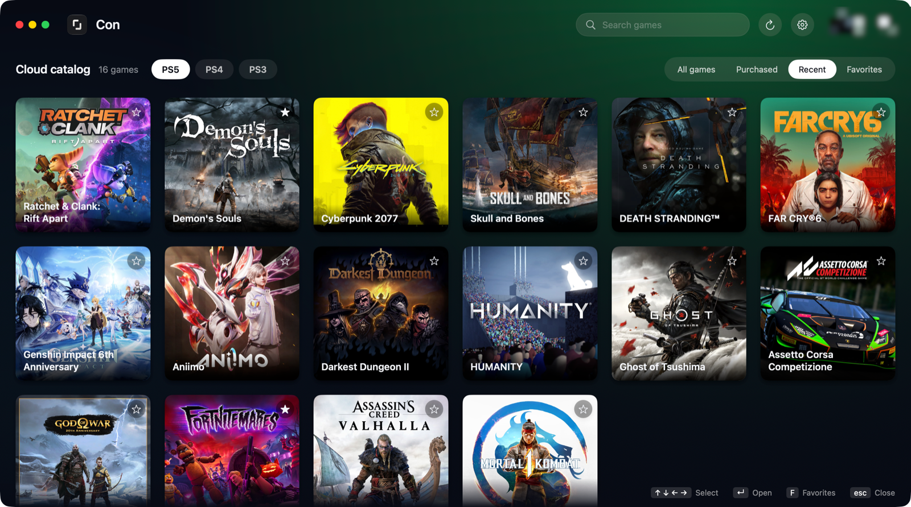

<div align="center">


# Con

**Unofficial PS Plus cloud gaming client for Mac, Windows and Android.**

Stream PS5, PS4 and PS3 games from the PS Plus cloud catalogue, no console needed,<br>
with a DualSense, another gamepad or a keyboard and mouse.

[](https://github.com/houqai/Con-app/releases/latest)


<br>

<a href="https://github.com/houqai/Con-app/releases/download/v0.5.1/Con-0.5.1-macos.dmg"></a>
&nbsp;
<a href="https://github.com/houqai/Con-app/releases/download/v0.5.1/Con-0.5.1-windows-x64.zip"></a>
&nbsp;
<a href="https://github.com/houqai/Con-app/releases/download/v0.5.1/Con-0.5.1-android.apk"></a>

<sub>Version 0.5.1 · <a href="https://github.com/houqai/Con-app/releases">all versions</a></sub>

<br><br>



</div>

## What's new in 0.5.1

The source is open now (GPL-3.0).

One thing changed because of that. Sony only lets you play on a server that's less than 80 ms away. Con used to quietly tell Sony a lower number when your nearest server was further than that. It's against Sony's rules, so now it's a setting you turn on yourself: **Distant servers**, in the stream settings. It's off by default.

So if a game won't start and Con says the server is too far, turn on Distant servers.

## Get started

1. **Install the app** for your system, see [Download](#download).
2. **Sign in with your PlayStation account.** Con opens Sony's own sign-in page; your password goes to Sony, not to me.
3. **Pick a game and press Play.** The game starts on a Sony server near you.

Cloud streaming needs a **PlayStation Plus Premium** subscription and a game you own or that is in the catalogue of your plan.

## What it does

- **The whole cloud catalogue.** PS5, PS4 and PS3 games of PS Plus, with your purchases, recently played games and favourites, search, and a page for every game with screenshots from the PlayStation Store.
- **Your controller, as on a console.** DualSense, DualShock 4 and other gamepads. On Windows, a DualSense connected by USB plays the game's haptics; adaptive triggers, light bar and rumble work too.
- **Keyboard and mouse.** Every button can be mapped to a key; the mouse can steer the camera.
- **Sharper picture.** An upscaler that enlarges the stream two, three or four times: FSR 1 and Anime4K everywhere, NIS on Windows, MetalFX on the Mac.
- **Smoother picture.** Frame generation doubles the frame rate on the Mac and on Windows with an AMD graphics card.
- **Trophy notifications.** A trophy you earn while streaming shows up over the game. You can turn this off in the settings.
- **Live stream figures.** Resolution, frame rate, delay, bitrate and lost frames, one click away.
- **A game without sound from the server?** Sometimes Sony's server starts a game silently. Con notices it after 30 seconds and offers to restart the game.
- **In your language.** English, Russian, German, French, Spanish, Italian, Portuguese, Polish, Japanese, Korean and Chinese.
- **Gamepad-first interface.** The whole app can be used from the couch with a controller.

## How it is made

Con is written in Swift and Rust. The interface on every system, the PlayStation sign-in and cloud client, and the streaming engine are its own code: the engine (network transport, encryption, video, audio and controller feedback) is written from scratch in Rust. On Android, the screens are a small Java layer over the same Swift and Rust core. Apart from the operating system, Con depends on nothing but the components listed under [Third-party software](#third-party-software).

The streaming engine is written from scratch from a protocol description, which is in [docs/protocol](docs/protocol/README.md).

## Download

| System | Files | Runs on |
|---|---|---|
| **macOS** | [Disk image](https://github.com/houqai/Con-app/releases/download/v0.5.1/Con-0.5.1-macos.dmg) | macOS 26 or newer, Apple Silicon |
| **Windows** | [Archive](https://github.com/houqai/Con-app/releases/download/v0.5.1/Con-0.5.1-windows-x64.zip) | Windows 10 and 11, 64-bit |
| **Android** | [APK](https://github.com/houqai/Con-app/releases/download/v0.5.1/Con-0.5.1-android.apk) | Android 9 or newer, 64-bit ARM |

A Linux version exists, but it is not part of this release yet: it still has to be tested on SteamOS.

### macOS

Open the disk image and drag Con to Applications. The app is not notarized by Apple yet, so macOS stops its first launch: open **System Settings → Privacy & Security**, choose **Open Anyway** next to Con and confirm.

### Windows

Unpack the archive anywhere and run `con-app.exe`. Windows may warn about an unknown publisher: the app has no paid certificate yet, so the checksum below is how you know the file is mine. Sign-in uses Microsoft Edge WebView2, which Windows 11 already has; on Windows 10, install the [WebView2 Runtime](https://developer.microsoft.com/microsoft-edge/webview2/) if sign-in does not open.

### Android

Download the APK on the phone and open it. Android asks to allow installing apps from your browser or file manager once. An on-screen gamepad appears when no controller is connected.

### Checksums

SHA-256 of every file is in [SHA256SUMS.txt](https://github.com/houqai/Con-app/releases/download/v0.5.1/SHA256SUMS.txt) of the release.

## Privacy

- You sign in on Sony's own page. Con keeps only the sign-in tokens, in your system's keychain (Keychain on the Mac, Credential Manager on Windows, the Android Keystore).
- Con talks only to Sony and the PlayStation Store. There is no account of mine, no analytics and no telemetry.
- Diagnostic logs stay on your device and never contain tokens, cookies or Sony's responses.

## Questions

**Is this an official PlayStation app?** No. Con is an independent app and is not made, endorsed or supported by Sony Interactive Entertainment.


**Why does a game sometimes take a minute to start right after I closed another?** Sony keeps the previous cloud session for about a minute. Con ends its own previous session by itself and waits for one started on another device.

## Third-party software

Besides the operating system itself, Con uses only these open-source components. Exact versions and licence texts are in `THIRD-PARTY-NOTICES.md` and the `licenses` folder of each download.

- **In every version:** Opus for audio, and Rust crates for cryptography and talking to the system (the RustCrypto crates for AES, GCM, SHA-2, HMAC, HKDF and secp256k1 with their helpers; rand, base64, socket2, thiserror, zerocopy, zeroize, libc and the small crates they build on), all linked into the engine. The upscaler shaders come from AMD FidelityFX Super Resolution 1 and Anime4K, plus NVIDIA Image Scaling on Windows.
- **macOS:** nothing else.
- **Windows:** [SDL 2.32.10](https://github.com/libsdl-org/SDL/releases/tag/release-2.32.10); [FFmpeg 8.1.3](https://github.com/BtbN/FFmpeg-Builds/releases/tag/autobuild-2026-10-07-13-07) (LGPL build, as separate libraries); Cairo and Pango with GLib, HarfBuzz, FreeType, Fontconfig, FriBidi, pixman, libpng, Expat, PCRE2, libffi, zlib, libintl and win-iconv from [gvsbuild 2026.8.0](https://github.com/wingtk/gvsbuild/releases/tag/2026.8.0); the Swift runtime and Foundation with ICU; Microsoft's WebView2 loader and Visual C++ runtime; the Inter font; Rust crates for Windows (windows-rs, webview2-com, sdl2-sys).
- **Android:** the Swift runtime and Foundation with ICU, LLVM libc++, and Rust crates for Android (jni, ndk-sys and their helpers).

## Building from source

You need a Mac with Apple Silicon, Xcode (Swift 6), Rust and Homebrew `cmake`. The Mac app:

```sh
Engine/build.sh aarch64-apple-darwin
Platform/build.sh aarch64-apple-darwin
swift test --scratch-path work/sole-review-build
./build.sh
```

`build.sh` signs the app with a local identity in `work/sole-signing`. Windows and Android are built on the Mac too, Linux on a Linux machine. Every script, target and requirement is in [docs/BUILD.md](docs/BUILD.md); an overview of the code is in [docs/OVERVIEW.md](docs/OVERVIEW.md).

Module names (`Sole`, `SoleCore`, …), the identifier `app.sole.desktop` and the `sole.*` settings keys come from the app's former name, Sole.

## License

Con is free software: you can redistribute it and/or modify it under the terms of the [GNU General Public License, version 3](LICENSE.txt), as published by the Free Software Foundation. Copyright © 2026 houqai.

As an additional permission under section 7 of the license, you may link Con with the Microsoft WebView2 loader, the Microsoft Visual C++ runtime and AMD's AMF runtime, and distribute the result, without those components having to be under the GPL.

Third-party components keep their own licenses, listed in [THIRD-PARTY-NOTICES.md](THIRD-PARTY-NOTICES.md).

## Help test

Two parts of Con are built but not tested yet, and reports are welcome in [Issues](https://github.com/houqai/Con-app/issues):

- **Linux and Steam Deck.** Build it on Linux as described in [docs/LINUX.md](docs/LINUX.md).
- **Remote Play to your own PS4 or PS5.** It is hidden in the app: set `consolesShown` to `true` in `Sources/SoleLogic/Game.swift` and build Con.

## Support the project

Con is free. If you would like to support it:

| Currency | Network | Address |
|---|---|---|
| USDC | Solana | `3b7GpfNREjEFWHvCf7T7HJC91TyuapHiLnFPZTcDva9m` |
| USDT | TRON (TRC-20) | `TAo3KYh5VQwkRGiiUPKPR7GrAwegw5U1tY` |

Please send only the currency on the network shown next to its address.

<sub>PlayStation, PS5, PS4, PS3, PlayStation Plus, DualSense and DualShock are trademarks of Sony Interactive Entertainment Inc. Con is not affiliated with Sony.</sub>
